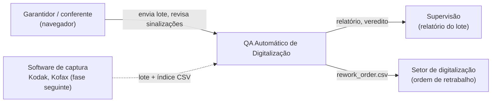
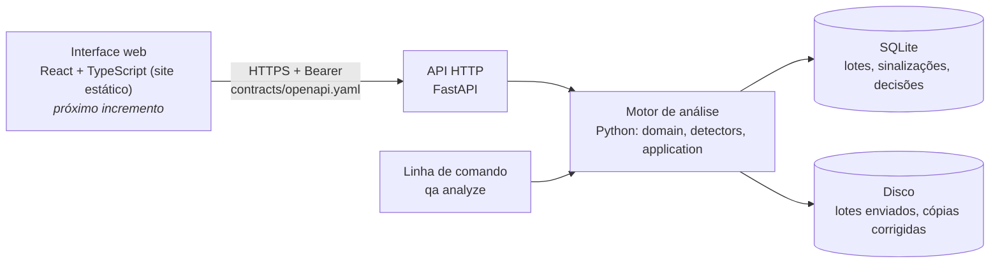
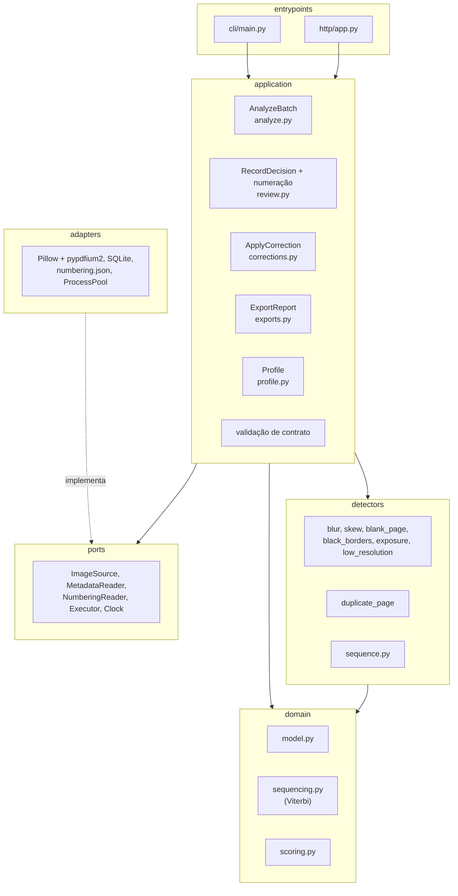
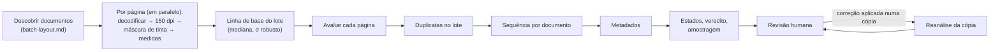

# Arquitetura (C4)

Diagramas como código (Mermaid), renderizados no site da documentação.

## Contexto

## Contêineres

Na PoC, API e motor rodam no mesmo contêiner Docker (`deploy/Dockerfile`); a análise usa
um pool de processos com todos os núcleos.

## Componentes do motor

## Pipeline

